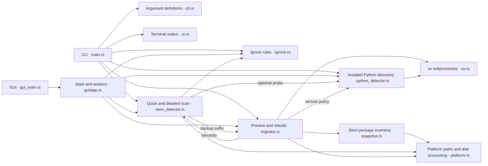
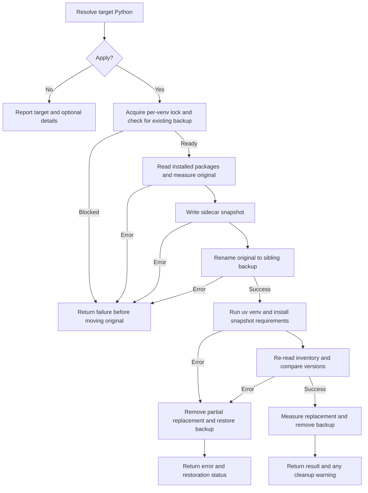

# uv-migrator code map

Both binaries call the `uv_migrator` library. Start in the relevant frontend for input and output changes, or in `migrator.rs` for package preservation and rollback.

## Architecture

| Task | Start here | Check alongside |
| --- | --- | --- |
| CLI flags, output, exit status | [src/cli.rs](src/cli.rs), [src/main.rs](src/main.rs) | `SearchArgs` is shared by scan and migrate. The handlers own JSON envelopes and `ui.rs` renders text. `migrate` previews unless `--apply` is set. Empty results exit successfully. |
| Traverse roots and identify venvs | [src/venv_detector.rs](src/venv_detector.rs) | `scan_with_inspection` prunes hard-coded directories and backups, stops descending at each venv, and sorts by parent path and venv path. Quick mode reads config and manifest presence. Detailed mode also measures size, lists package filenames, and probes unresolved versions. |
| Ignore rules and editor | [src/ignore.rs](src/ignore.rs), [src/gui/app.rs](src/gui/app.rs) | `IgnoreEngine::load` combines defaults, an explicit file or root/working-directory file, and CLI excludes. Invalid or unreadable rules propagate an error. The GUI validates edits before writing and requires a successful scan of the current input. |
| Python selection and downloads | [src/migrator.rs](src/migrator.rs), [src/python_detector.rs](src/python_detector.rs), [src/uv.rs](src/uv.rs) | `PythonPolicy` implements `same`, `latest-patch`, `latest`, and numeric overrides. The two installed-runtime policies discover candidates as needed. uv-managed discovery reads the directory reported by `uv python dir`. `uv venv` handles runtime downloads and accepts `--no-python-downloads`. |
| Package inventory and verification | [src/snapshot.rs](src/snapshot.rs), [src/platform.rs](src/platform.rs) | `read_installed` requires readable local site-packages and package metadata. It supports a usable filename fallback when `METADATA` is absent. `render` writes requirements with direct-source information. `diff` checks expected names and versions and accepts extra distributions. Scan package lists come from a separate filename reader. |
| GUI selection and worker events | [src/gui/app.rs](src/gui/app.rs) | Startup checks uv and its cache directory. The user chooses a root and starts the first scan. `start_background_scan` captures the root and ignore inputs, tags each venv scan with a generation, and triggers `start_python_discovery` once per session (with an explicit Re-scan button and its own generation). `poll_events` refreshes venvs and runtimes only for matching generations. Selection uses the full venv path. `start_migration` checks scan readiness and allows one active job per GUI instance. |

## Migration lifecycle

The CLI defaults to a preview and the GUI exposes a dry-run toggle. A quick preview leaves size and package count unset. A detailed preview reads the same strict inventory used in apply. Apply jobs process environments sequentially.

With force reinstall enabled, `prepare_migration_cache` builds and verifies a temporary environment for each nonempty inventory before the normal rebuild loop starts. The temporary environments use uv's configured cache and are removed after preparation. A preparation failure prevents the batch from entering the rebuild loop.

- Apply reserves `<venv>.uv-migrator-backup.lock` across processes. After a crash, confirm the migration has stopped before clearing a stale lock. If the result points to a surviving backup, recover it before retrying.
- The requirements sidecar is `<venv>.uv-migrator-snapshot.txt`. The original moves to `<venv>.uv-migrator-backup` while the replacement is built. An existing backup blocks a retry before the sidecar is written.
- The size fields report apparent file sizes. Volume free-space measurements are taken only for real migration batches. A successful replacement can still report a cleanup warning if backup deletion fails.
- Two sibling environments share a project-relative label. Use `venv_dir` as the selection or migration identity.

## Verification

- Run `cargo test --locked --all-targets`. [Workflow tests](tests/workflows.rs) cover fast inspection, preview output and exit status, ignore errors, strict inventories, backup preservation, and restore after a subprocess failure. GUI unit tests cover stale scan results, sibling selection, and overlapping jobs.
- For changes to the uv subprocesses, exercise an apply with a disposable venv and verify success, install failure, and version mismatch. Use a local wheel and `UV_OFFLINE=1` to exercise installs without network access.
- To measure scan or preview performance, create a synthetic tree with populated venvs and compare the same commands with and without `--details`. Verify that candidate paths match before comparing timings.
- Windows debug-build sample with 24 venvs, 80 distributions per venv, and eight sample module files per distribution. The median of five timed runs was 49 ms for default scan and 630 ms with details. Migration preview was 47 ms by default and 1,284 ms with details. All runs returned the same 24 paths.
